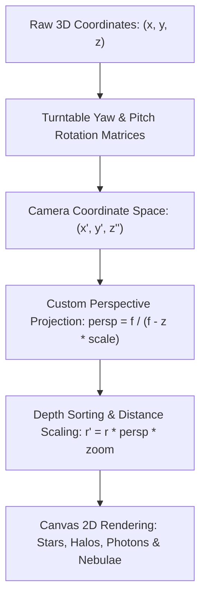
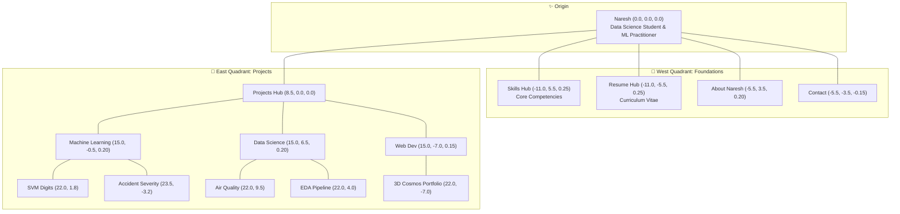

<div align="center">

# 🌌 3D Superpower Cosmos Portfolio
### *Mathematical 3D Constellation Engine & Data Science Showcase*

<p align="center">
  <strong>A zero-dependency, hardware-accelerated 3D celestial universe web application built with React 19, TypeScript, and HTML5 Canvas.</strong>
</p>

<p align="center">
  <a href="https://nareshkumar17.netlify.app/" target="_blank">
    
  </a>
  <a href="https://nareshkumar17.netlify.app/">
    
  </a>
</p>

[](https://react.dev/)
[](https://www.typescriptlang.org/)
[](https://developer.mozilla.org/en-US/docs/Web/API/Canvas_API)
[](https://vitejs.dev/)
[](https://nareshkumar17.netlify.app/)
[](#-security--defenses)
[](LICENSE)

<br/>

[🪐 3D Cosmos Engine](#-the-3d-cosmos-engine) •
[📐 3D Mathematics & Physics](#-3d-mathematical-projection-pipeline) •
[🗺️ Spatial Constellation Layout](#️-3d-spatial-constellation-architecture) •
[✨ Key Features](#-key-features) •
[📊 Project Tracks](#-featured-project-tracks) •
[🛠️ Tech Stack](#️-technology-stack) •
[📁 Structure](#-project-structure) •
[⚡ Quickstart](#-getting-started)

</div>

---

## 🌟 Overview: A 3D Universe for Data Science

[nareshkumar17.netlify.app](https://nareshkumar17.netlify.app/) is a custom-engineered, interactive **3D celestial cosmos portfolio**. Rather than presenting static cards or basic grid layouts, this portfolio models technical competencies, machine learning algorithms, and software architectures as an interconnected celestial constellation in 3D coordinate space.

### Why a Custom 3D Canvas Engine?
Most 3D web experiences rely on heavyweight external WebGL engines (Three.js, Babylon.js) that bundle megabytes of overhead, trigger long shader compilation times, and strain mobile GPUs.

This portfolio uses a **zero-dependency, purely mathematical 3D projection engine built directly on HTML5 Canvas 2D**:
* **Locked 60 FPS Rendering**: Ultra-low memory footprint running continuous `requestAnimationFrame` physics loops.
* **Instant Load Times**: Zero external 3D libraries or heavy 3D asset bundles.
* **Complete Mathematical Control**: Direct control over rotational matrices, camera easing, depth sorting, and particle dynamics.
* **Responsive Coordinate Space**: Fully interactive turntable rotation, inertia damping, and smooth camera glide across desktop and mobile.

---

## 🪐 The 3D Cosmos Engine

The visualization maps nodes into an abstract Euclidean 3-space $\mathbb{R}^3$, transforming and projecting them continuously onto the 2D viewport.



### Core Engine Capabilities
1. **Turntable Camera Physics**: Continuous ambient yaw rotation with interactive pointer drag, inertia damping, and smooth target camera gliding.
2. **Volumetric Cosmic Nebulae**: Procedural atmospheric dust clouds generated mathematically using the Box-Muller Gaussian transformation.
3. **Animated Photon Flow Trajectories**: Dynamic quadratic and cubic Bézier energy trails traveling between connected star nodes.
4. **Interactive Node Focusing**: Clicking any constellation node glides the camera into focused inspection mode with coordinated sidebar drawers or dedicated page transitions.

---

## 📐 3D Mathematical Projection Pipeline

### 1. Rotational Transformation Matrices
Given a 3D coordinate $(x, y, z)$, camera yaw angle $\theta$ (horizontal turntable), and pitch angle $\phi$ (vertical elevation):

$$\begin{aligned}
x' &= x \cos\theta - z \sin\theta \\
z' &= x \sin\theta + z \cos\theta \\
y' &= y \cos\phi - z' \sin\phi \\
z'' &= y \sin\phi + z' \cos\phi
\end{aligned}$$

### 2. Perspective Projection Divide
Coordinates are projected from 3D camera space to 2D canvas pixel coordinates $(X_{\text{screen}}, Y_{\text{screen}})$ using focal length scaling factor $f = 6.0$:

$$\text{persp} = \frac{f}{f - z'' \cdot 0.4}$$

$$X_{\text{screen}} = \text{Center}_X + (x' - \text{Cam}_X) \cdot S \cdot \text{persp}$$

$$Y_{\text{screen}} = \text{Center}_Y + (y' - \text{Cam}_Y) \cdot S \cdot \text{persp}$$

*Where $S$ is the responsive screen scale factor and $(\text{Cam}_X, \text{Cam}_Y)$ is the active focal camera position.*

### 3. Box-Muller Gaussian Volumetric Nebula
Nebula cloud density distributions are procedurally generated at startup using the Box-Muller transform to yield standard normal distributions $Z \sim \mathcal{N}(0, 1)$:

$$Z_0 = \sqrt{-2 \ln U_1} \cos(2\pi U_2), \quad Z_1 = \sqrt{-2 \ln U_1} \sin(2\pi U_2)$$

*Where $U_1, U_2 \in (0, 1)$ are uniform random variables.*

---

## 🗺️ 3D Spatial Constellation Architecture

Nodes are spatially distributed across wide coordinate bounds to ensure clarity and eliminate label overlap:



---

## ✨ Key Features

### 1. Streamlined Top Navigation Bar
A clean 4-pill glassmorphic header operating directly on the 3D universe:
* `[ • NARESH ]` — Resets camera focus to the center origin $(0, 0, 0)$.
* `[ • SKILLS ]` — Opens the comprehensive developer documentation page (`/skills`).
* `[ • PROJECTS ]` — Glides the 3D camera to the projects hierarchy cluster $(8.5, 0, 0)$.
* `[ • RESUME ]` — Opens the dedicated standalone Curriculum Vitae sheet (`/resume`).

### 2. Full Technical Documentation Page (`/skills`)
A dedicated engineering specification page structured like modern developer documentation:
* **Specification 01.0 (Python & Machine Learning)**: Spec tables for `scikit-learn`, `pandas`, `NumPy`, `Matplotlib`, `Seaborn`, and `SMOTE` with verified project case studies.
* **Specification 02.0 (C++ & Systems Programming)**: Rigorous breakdown of `C++20`, RAII memory management, OOP architecture, and asymptotic complexity analysis.
* **Specification 03.0 (Web Development & 3D Visual Computing)**: Architectural details on React 19, TypeScript, HTML5 Canvas 2D perspective math, and cloud hosting.
* **Navigation**: One-click filter pills, anchor bookmarks, and sticky `← Back to Portfolio` return button.

### 3. Standalone Resume Page (`/resume`)
* **Clean Document Flow**: Full natural vertical scrolling with immediate render lifecycle.
* **Distraction-Free**: Dedicated view without background canvas overhead or navigation bars.
* **Print Optimized**: Complete `@media print` support for physical export or PDF generation.

---

## 📊 Featured Project Tracks

All projects in the 3D cosmos represent real, open-source personal implementations:

| Domain | Project | Key Technologies | Highlights | Live Source |
| :--- | :--- | :--- | :--- | :--- |
| **Machine Learning** | **SVM Handwritten Digits Recognition** | Python, scikit-learn, SVM, RBF Kernel | Regularization parameter tuning ($C, \gamma$), ROC diagnostics, margin separation. | [GitHub](https://github.com/Naresh-Kumar17/svm-handwritten-digits) |
| **Machine Learning** | **Road Accident Severity Prediction** | Python, scikit-learn, SMOTE, pandas | Addressed severe class imbalance with synthetic oversampling to maximize critical injury recall. | [GitHub](https://github.com/Naresh-Kumar17/Road-Accident-Severity) |
| **Data Science** | **Air Quality Forecasting** | Python, pandas, STL Decomposition | Seasonal-trend decomposition with rolling lagged windows to forecast particulate matter episodes. | [GitHub](https://github.com/Naresh-Kumar17/Air_Quality_Forcasating-) |
| **Data Science** | **Exploratory Data Analysis Pipeline** | pandas, NumPy, Matplotlib, Seaborn | Distribution analysis, automated anomaly detection, and correlation visual pipelines. | [Showcase](https://nareshkumar17.netlify.app/projects) |
| **Web Development** | **Interactive 3D Cosmos Portfolio** | React 19, TypeScript, HTML5 Canvas 2D | Custom perspective engine, turntable camera physics, 60 FPS particle dynamics. | [Repository](https://github.com/Naresh-Kumar17/portoflio_naresh) |

---

## 🛠️ Technology Stack

```mermaid
graph LR
    subgraph Core ["💻 Frontend Architecture"]
        R19["React 19"]
        TS["TypeScript 5.9 (Strict)"]
        VITE["Vite 8"]
        ROUTER["React Router 7"]
    end

    subgraph Graphics ["🪐 3D Visual Engine"]
        CANVAS["HTML5 Canvas 2D Context"]
        MATH["Trigonometric Projection Matrices"]
        MOTION["Motion (Page Transitions)"]
    end

    subgraph DesignSystem ["🎨 Styling & UI"]
        CSS["Hardware-Accelerated Vanilla CSS"]
        GLASS["Glassmorphism Tokens"]
        ICONS["Lucide React"]
    end

    subgraph Hosting ["☁️ Cloud & CDN"]
        NETLIFY["Netlify Edge CDN"]
    end

    Core --> Graphics
    Graphics --> DesignSystem
    DesignSystem --> Hosting
```



---

## 📁 Project Structure

```text
Portfolio/
├── public/                     # Static assets (profile photo, favicons, og-image)
├── src/
│   ├── assets/                 # Vector badges and cosmos visual assets
│   ├── components/             # UI & 3D Canvas visual components
│   │   ├── SuperpowerCosmos.tsx   # 🪐 Core 3D HTML5 Canvas constellation engine
│   │   ├── SuperpowerCosmos.css   # Styling for 3D HUD, tabs & slide drawer
│   │   ├── Navbar.tsx             # Responsive header navigation
│   │   ├── CommandPalette.tsx     # Quick search palette (Ctrl+K)
│   │   ├── CursorGlow.tsx         # Ambient cursor pointer follower
│   │   └── ...
│   ├── contexts/               # Application state (ThemeContext, I18nContext)
│   ├── data/                   # Structured portfolio datasets
│   │   ├── profile.ts             # Bio, FAST-NUCES education & contact info
│   │   ├── projects.ts            # Machine Learning, Data Science & Web projects
│   │   └── skills.ts              # Core competencies and toolchains
│   ├── pages/                  # Route views
│   │   ├── HomePage.tsx           # Fullscreen 3D Cosmos view
│   │   ├── SkillsPage.tsx         # 📖 Full Technical Documentation page
│   │   ├── ResumePage.tsx         # 📄 Standalone Curriculum Vitae sheet
│   │   ├── ProjectsPage.tsx       # Projects directory & search filters
│   │   └── ProjectDetailPage.tsx  # In-depth project case study view
│   ├── App.tsx                 # Route coordinator & layout manager
│   ├── index.css               # Global theme tokens, typography & CSS variables
│   └── main.tsx                # Application root mounting
├── netlify.toml                # Netlify deployment & SPA routing redirects
├── vercel.json                 # Security headers & Content Security Policy (CSP)
└── package.json                # Dependencies and scripts
```

---

## 🛡️ Security & Hardening

* [x] **Strict Content Security Policy (CSP)**: Disallows inline untrusted script execution, restricts frame ancestors, and isolates script sources.
* [x] **Zero External 3D Runtimes**: Eliminates external WebGL supply-chain dependencies.
* [x] **Input Sanitization**: Strict regex checks against CRLF injection and HTML escaping.
* [x] **Production Headers**: `X-Frame-Options: DENY`, `X-Content-Type-Options: nosniff`, and `Strict-Transport-Security`.

---

## ⚡ Getting Started

### Prerequisites
* **Node.js**: v18.0.0 or higher
* **npm**: v9.0.0 or higher

### Local Development

```bash
# 1. Clone the repository
git clone https://github.com/Naresh-Kumar17/portoflio_naresh.git

# 2. Enter project directory
cd portoflio_naresh

# 3. Install dependencies
npm install

# 4. Start local development server
npm run dev
```

Visit [`http://localhost:5173`](http://localhost:5173) in your browser.

### Production Build

```bash
# Build optimized production bundle with TypeScript type-checking
npm run build

# Preview production build locally
npm run preview
```

---

## 👤 Author

**Naresh Kumar**  
*BS Data Science Undergraduate — FAST-NUCES Karachi (2025 – 2029)*  
*Applied Machine Learning Practitioner & Computational Thinker*

* 🌐 **Live Portfolio**: [nareshkumar17.netlify.app](https://nareshkumar17.netlify.app/)
* 🐙 **GitHub**: [@Naresh-Kumar17](https://github.com/Naresh-Kumar17)
* 💼 **LinkedIn**: [naresh-kumar-ds](https://www.linkedin.com/in/naresh-kumar-ds)
* 📧 **Email**: [wdnaresh@gmail.com](mailto:wdnaresh@gmail.com)

---

<div align="center">
  <sub>Built with React 19, TypeScript, and a custom HTML5 Canvas 2D 3D Engine. © 2026 Naresh Kumar.</sub>
</div>
