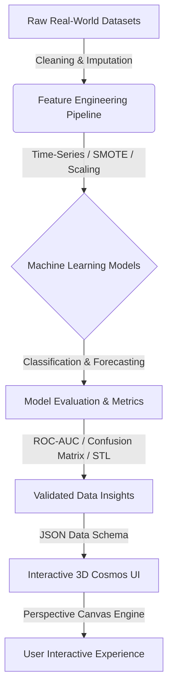

<div align="center">

# 🌌 Naresh Kumar — Interactive Data Science Portfolio

<p align="center">
  <strong>Transforming Raw Data into Decisions Through Machine Learning, Predictive Modeling & Mathematical 3D Visualizations.</strong>
</p>

[](https://khi.nu.edu.pk/)
[](https://python.org)
[](https://scikit-learn.org/)
[](https://react.dev/)
[](https://www.typescriptlang.org/)
[](LICENSE)

<br/>

[🚀 Live Preview](#-live-showcase) •
[📊 Featured ML Projects](#-featured-data-science-projects) •
[🌌 3D Cosmos Engine](#-interactive-3d-cosmos-engine) •
[🛠️ Data Science Stack](#️-data-science-tech-stack) •
[🏗️ Architecture](#️-system-architecture) •
[⚡ Quickstart](#-getting-started) •
[📬 Connect](#-connect)

</div>

---

## 🌟 Overview

Welcome to the repository for **Naresh Kumar's** Data Science & Machine Learning Portfolio.

This portfolio is an **interactive mathematical 3D constellation universe** engineered with pure HTML5 Canvas and mathematical camera physics to showcase end-to-end Data Science workflows — from exploratory analysis and statistical modeling to hyperparameter optimization and predictive machine learning.

```
                           🌌 3D CONSTELLATION NODES 🌌
                                      |
         +----------------------------+----------------------------+
         |                                                         |
  [📈 ML & Predictive Models]                               [🔬 Academic Foundations]
  ├── SVM Digit Classifier                                  ├── Data Structures & Algorithms
  ├── Air Quality Forecasting (STL/PM)                      ├── OOP C++ Tournament Simulations
  └── Road Accident Severity (SMOTE/XGB)                    └── Assembly 2048 Register Physics
```

---

## 📊 Featured Data Science Projects

<details open>
<summary><b>🔥 1. SVM Handwritten Digits Recognition</b> <i>(Machine Learning Classifier)</i></summary>
<br/>

* **Repository**: [`Naresh-Kumar17/svm-handwritten-digits`](https://github.com/Naresh-Kumar17/svm-handwritten-digits)
* **Domain**: Supervised Classification, Computer Vision & Pattern Recognition
* **Technologies**: `Python`, `scikit-learn`, `SVM`, `NumPy`, `Matplotlib`, `GridSearchCV`

#### 🎯 Key Achievements & Methodology:
- **Kernel Benchmarking**: Systematically contrasted **Linear**, **Polynomial**, and **Radial Basis Function (RBF)** kernels.
- **Decision Boundary Optimization**: Tuned regularization penalty $C$ and kernel coefficient $\gamma$ via cross-validated grid search.
- **Multiclass Strategy**: Implemented One-vs-Rest (OvR) and One-vs-One (OvO) decision margins with full confusion matrix analytics.

```python
# Sample Optimization Pipeline Snippet
from sklearn.svm import SVC
from sklearn.model_selection import GridSearchCV

param_grid = {'C': [0.1, 1, 10, 100], 'gamma': ['scale', 'auto', 0.01, 0.001], 'kernel': ['rbf']}
grid = GridSearchCV(SVC(decision_function_shape='ovr'), param_grid, cv=5, scoring='accuracy')
grid.fit(X_train_scaled, y_train)
```
</details>

<details open>
<summary><b>🌫️ 2. Air Quality Forecasting</b> <i>(Time-Series Predictive Modeling)</i></summary>
<br/>

* **Repository**: [`Naresh-Kumar17/Air_Quality_Forcasating-`](https://github.com/Naresh-Kumar17/Air_Quality_Forcasating-)
* **Domain**: Environmental Data Science, Atmospheric Analytics & Temporal Forecasting
* **Technologies**: `Python`, `pandas`, `Time-Series Analysis`, `STL Decomposition`, `Matplotlib`

#### 🎯 Key Achievements & Methodology:
- **Temporal Decomposition**: Applied **STL (Seasonal and Trend decomposition using Loess)** to decouple diurnal traffic cycles from long-term meteorological trends.
- **Stationarity & Differencing**: Validated stationarity via Augmented Dickey-Fuller (ADF) hypothesis testing.
- **Rolling Windows**: Engineered lagged atmospheric features (PM2.5, PM10, temperature inversions) preventing temporal data leakage.
</details>

<details open>
<summary><b>🚦 3. Road Accident Severity Prediction</b> <i>(Imbalanced Classification Pipeline)</i></summary>
<br/>

* **Repository**: [`Naresh-Kumar17/Road-Accident-Severity`](https://github.com/Naresh-Kumar17/Road-Accident-Severity)
* **Domain**: Public Safety, Risk Modeling & Predictive Analytics
* **Technologies**: `Python`, `pandas`, `scikit-learn`, `SMOTE`, `Feature Engineering`

#### 🎯 Key Achievements & Methodology:
- **Severe Class Imbalance**: Solved severe class distribution skew using **Synthetic Minority Over-sampling Technique (SMOTE)** and class-weighted cost functions.
- **Feature Engineering**: Extracted spatial-temporal risk coefficients, junction geometry interactions, and lighting impact metrics.
- **Threshold Calibration**: Tuned probability decision thresholds to maximize high-severity recall while preserving precision.
</details>

---

## 🌌 Interactive 3D Cosmos Engine

The portfolio includes a zero-dependency **HTML5 Canvas 3D projection engine** that renders astronomical starfields and interactive constellation nodes:

<details>
<summary><b>🔍 Expand Mathematical Camera Projection Details</b></summary>
<br/>

The cosmos engine uses 3D-to-2D perspective projection mathematics without heavy WebGL overhead:

$$x_{\text{proj}} = \frac{x \cdot f}{z + d} + \frac{W}{2}, \quad y_{\text{proj}} = \frac{y \cdot f}{z + d} + \frac{H}{2}$$

* **Box-Muller Gaussian Distribution**: Generates organic volumetric cosmic nebulae.
* **Cubic Bézier Photons**: Interpolates photon energy particles traveling along constellation trajectories.
* **Camera Orbit Physics**: Smooth yaw/pitch inertial damping with drag sensitivity and zoom focal scaling.
</details>

---

## 🛠️ Data Science Tech Stack

| Category | Core Technologies | Status |
| :--- | :--- | :--- |
| **Languages** | `Python` (Primary), `SQL`, `TypeScript`, `C/C++` | 🟢 Actively Used |
| **Data Manipulation** | `pandas`, `NumPy`, `Data Wrangling`, `Data Cleaning` | 🟢 Production Ready |
| **Statistical Analysis** | `scikit-learn`, `Hypothesis Testing`, `Probability`, `Linear Algebra` | 🟡 Intermediate |
| **Visualization** | `Matplotlib`, `Seaborn`, `HTML5 Canvas 2D`, `Plotly` | 🟢 Advanced |
| **Environments & Tools** | `Jupyter Notebooks`, `VS Code`, `Git / GitHub`, `Vite` | 🟢 Daily Driver |
| **Deep Learning & MLOps** | `PyTorch`, `TensorFlow`, `XGBoost`, `Docker` | 🔵 Expanding Roadmap |

---

## 🏗️ System Architecture



---

## 🛡️ Enterprise Security Hardening

This portfolio features production-grade security practices:

- [x] **Zero Injection Vectors**: Form inputs sanitized against CRLF header injection and persistent XSS.
- [x] **Anti-Bot Defense**: Invisible honeypot traps filtering automated spam without CAPTCHA friction.
- [x] **Rate Limiting**: Cooldown throttles on form submissions preventing denial-of-service spam.
- [x] **Strict Security Headers**: HSTS, `X-Frame-Options: DENY`, `X-Content-Type-Options: nosniff`, and custom Content Security Policies.

---

## ⚡ Getting Started

Run the interactive portfolio locally in under 60 seconds:

```bash
# 1. Clone the repository
git clone https://github.com/Naresh-Kumar17/portoflio_naresh.git

# 2. Enter project directory
cd portoflio_naresh

# 3. Install dependencies
npm install

# 4. Start local development server with HMR
npm run dev
```

Visit `http://localhost:5173` in your browser.

To create an optimized production build:
```bash
npm run build
```

---

## 📬 Connect

<div align="center">

**Naresh Kumar**  
*BS Data Science Undergraduate — FAST-NUCES Karachi*

[](https://github.com/Naresh-Kumar17)
[](https://www.linkedin.com/in/naresh-kumar-ds)
[](mailto:wdnaresh@gmail.com)

</div>