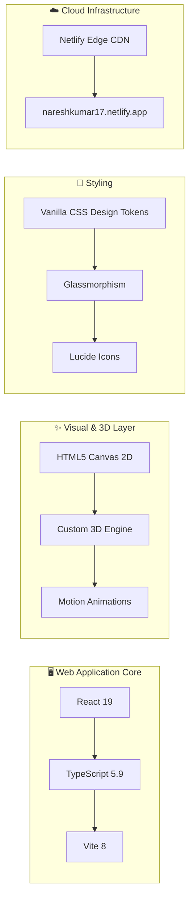

<div align="center">

# 🌌 Interactive 3D Cosmos Portfolio

<p align="center">
  <strong>A high-performance, interactive 3D universe web application showcasing Data Science & Machine Learning projects.</strong>
</p>

<p align="center">
  <a href="https://nareshkumar17.netlify.app/" target="_blank">
    
  </a>
  <a href="https://nareshkumar17.netlify.app/">
    
  </a>
</p>

[](https://react.dev/)
[](https://www.typescriptlang.org/)
[](https://vitejs.dev/)
[](https://nareshkumar17.netlify.app/)
[](#-security--defenses)
[](LICENSE)

<br/>

[🚀 Live Application](https://nareshkumar17.netlify.app/) •
[✨ Key Features](#-key-features) •
[🪐 3D Cosmos Engine](#-custom-3d-canvas-engine) •
[📊 Data Science Showcase](#-data-science-showcase-modules) •
[🛠️ Tech Stack](#️-tech-stack--tooling) •
[📁 Project Structure](#-folder-structure) •
[⚡ Quickstart](#-getting-started) •
[🚢 Deployment](#-deployment)

</div>

---

## 🌟 About The Project

This repository contains the source code for [nareshkumar17.netlify.app](https://nareshkumar17.netlify.app/) — an interactive, cosmos-themed web application designed to present Data Science research, machine learning experiments, and analytical models through a dynamic 3D celestial interface.

Rather than relying on heavy 3D rendering engines (like Three.js or Babylon.js), this project uses a **zero-dependency mathematical projection engine built directly on HTML5 Canvas**, achieving locked 60 FPS performance, instant loading speeds, and fluid camera transitions.

---

## ✨ Key Features

<details open>
<summary><b>🪐 1. Interactive 3D Celestial Universe</b></summary>
<br/>

- **Procedural Constellations**: Projects celestial nodes in 3D coordinate space mapping directly to project domains and technical milestones.
- **Physics-Based Camera Orbit**: Smooth yaw, pitch, damping inertia, and mouse/touch drag controls.
- **Volumetric Nebulae**: Procedural cosmic clouds generated using the Box-Muller Gaussian transform.
- **Photon Flow Trajectories**: Animated cubic Bézier photon pulses traveling between connected star nodes.
</details>

<details open>
<summary><b>📊 2. Data Science Project Explorer</b></summary>
<br/>

- **Case Study Modals & Dedicated Pages**: In-depth breakdowns of machine learning classifiers, time-series forecasting, and datasets.
- **Dynamic Metrics Display**: Direct visualization of model parameters, loss curves, confusion matrices, and key findings.
- **External Dataset & Code Links**: Instant links to Kaggle datasets, GitHub repositories, and Jupyter notebooks.
</details>

<details open>
<summary><b>📄 3. Interactive CV / Resume Engine</b></summary>
<br/>

- **Online Curriculum Vitae**: Clean, printable, and exportable CV formatted for recruiters.
- **Print Optimization**: Dedicated `@media print` CSS rules generating a clean physical document without navigation or canvas overhead.
- **PDF Download Integration**: Supports direct PDF delivery or in-browser printing.
</details>

<details open>
<summary><b>🌐 4. Multilingual & Theme System</b></summary>
<br/>

- **Internationalization (i18n)**: Seamless language switching powered by a lightweight typed context ([I18nContext.tsx](file:///f:/Portfolio/src/contexts/I18nContext.tsx)).
- **Custom Design Tokens**: Sleek glassmorphism, tailored HSL color palettes, and ambient glow shaders in pure Vanilla CSS.
</details>

---

## 🪐 Custom 3D Canvas Engine

The core cosmos visualization avoids heavy WebGL libraries by implementing mathematical camera physics directly in an HTML5 2D canvas context:

```
[3D Coordinate Space (x, y, z)]
             │
             ▼
   [Camera Yaw & Pitch Rotation] ──> [Matrix Transformation]
             │
             ▼
    [Perspective Divide: f / (z + d)]
             │
             ▼
 [Screen Projection (Xp, Yp)] + [Distance Scaling & Depth Alpha]
```

<details>
<summary><b>📐 View Perspective Projection Formula</b></summary>
<br/>

For each celestial point $(x, y, z)$ transformed by camera yaw $\theta$ and pitch $\phi$:

$$x' = x \cos\theta - z \sin\theta$$
$$z' = x \sin\theta + z \cos\theta$$
$$y' = y \cos\phi - z' \sin\phi$$
$$z'' = y \sin\phi + z' \cos\phi$$

Projected to 2D viewport coordinates with focal length $f$ and viewer distance $d$:

$$X_{\text{screen}} = \frac{x' \cdot f}{z'' + d} + \frac{\text{Width}}{2}, \quad Y_{\text{screen}} = \frac{y' \cdot f}{z'' + d} + \frac{\text{Height}}{2}$$

</details>

---

## 📊 Data Science Showcase Modules

The web application displays dedicated modules for active Data Science workflows:

| Project Module | Domain | Tech Stack | Live Source |
| :--- | :--- | :--- | :--- |
| **SVM Handwritten Digits** | Supervised Classification | Python, scikit-learn, SVM, RBF Kernel | [Repository](https://github.com/Naresh-Kumar17/svm-handwritten-digits) |
| **Air Quality Forecasting** | Time-Series Analytics | Python, pandas, STL Decomposition | [Repository](https://github.com/Naresh-Kumar17/Air_Quality_Forcasating-) |
| **Road Accident Severity** | Imbalanced ML Modeling | Python, scikit-learn, SMOTE | [Repository](https://github.com/Naresh-Kumar17/Road-Accident-Severity) |
| **Exploratory Data Analysis** | Statistical Discovery | pandas, NumPy, Matplotlib, Seaborn | Showcase Page |

---

## 🛠️ Tech Stack & Tooling



* **Framework**: React 19 (Component-driven SPA architecture)
* **Language**: TypeScript (Strict typing, interfaces for profiles, skills, and projects)
* **Bundler**: Vite 8 (Hot Module Replacement, lightning-fast builds)
* **Animations**: Motion (declarative smooth transitions)
* **Styling**: Vanilla CSS (Hardware-accelerated transforms, CSS custom properties, backdrop-filters)
* **Icons**: Lucide React

---

## 📁 Folder Structure

```text
Portfolio/
├── public/                 # Static assets (favicons, profile photo, og-image)
├── src/
│   ├── assets/             # Vector graphics & cosmos textures
│   ├── components/         # Reusable UI & 3D visualization components
│   │   ├── NicoUniverse.tsx   # Custom 3D canvas constellation cosmos engine
│   │   ├── Navbar.tsx         # Responsive glassmorphic navigation
│   │   ├── CursorGlow.tsx     # Ambient cursor follower shader
│   │   └── ...
│   ├── contexts/           # Application state (Theme, i18n, Audio)
│   ├── data/               # Single-source-of-truth datasets
│   │   ├── profile.ts         # Personal bio, education & contact config
│   │   ├── projects.ts        # Data science projects & case studies
│   │   ├── skills.ts          # Technical skill categorizations
│   │   └── translations.ts    # Multilingual translation dictionaries
│   ├── pages/              # Route views (Home, Projects, Skills, Resume, Contact)
│   ├── utils/              # Security sanitizers, rate-limiters, validators
│   ├── App.tsx             # Root router & page transition manager
│   ├── index.css           # Global design system & theme variables
│   └── main.tsx            # Application entry point
├── netlify.toml            # Netlify deployment & redirect configuration
├── vercel.json             # Security headers & CSP configuration
└── package.json            # Project dependencies & scripts
```

---

## 🛡️ Security & Defenses

The web application is hardened with enterprise-grade front-end security practices:

- [x] **Strict Content Security Policy (CSP)**: Mitigates XSS by locking script execution, object-src, and frame-ancestors.
- [x] **Input Sanitization**: Regex validation preventing CRLF header injection and script execution in contact forms.
- [x] **Anti-Bot Honeypot**: Invisible traps catching automated form spam without requiring CAPTCHAs.
- [x] **Client-Side Throttling**: Cooldown rate-limiters protecting form endpoints from rapid submission attacks.
- [x] **Production Headers**: `X-Frame-Options: DENY`, `X-Content-Type-Options: nosniff`, and `Strict-Transport-Security`.

---

## ⚡ Getting Started

To run this portfolio application locally on your machine:

### Prerequisites
* **Node.js**: v18.0.0 or higher
* **npm**: v9.0.0 or higher

### Installation & Run

```bash
# 1. Clone the repository
git clone https://github.com/Naresh-Kumar17/portoflio_naresh.git

# 2. Enter directory
cd portoflio_naresh

# 3. Install dependencies
npm install

# 4. Start local development server
npm run dev
```

Open [http://localhost:5173](http://localhost:5173) in your browser to view the application with hot module replacement (HMR).

### Production Build & Linting

```bash
# Type check and build optimized bundle
npm run build

# Preview production build locally
npm run preview

# Run Oxlint / Linter
npx oxlint
```

---

## 🚢 Deployment

This application is deployed on **Netlify** with automatic CI/CD triggers on the `main` branch.

* **Live URL**: [https://nareshkumar17.netlify.app/](https://nareshkumar17.netlify.app/)
* **Build Command**: `npm run build`
* **Publish Directory**: `dist`
* **Single Page App Routing**: Routed via `/*  /index.html  200` to support client-side React routes.

---

## 👤 Author

**Naresh Kumar**  
*BS Data Science Undergraduate — FAST-NUCES Karachi*

* **Live Portfolio**: [nareshkumar17.netlify.app](https://nareshkumar17.netlify.app/)
* **GitHub**: [@Naresh-Kumar17](https://github.com/Naresh-Kumar17)
* **LinkedIn**: [naresh-kumar-ds](https://www.linkedin.com/in/naresh-kumar-ds)
* **Email**: [wdnaresh@gmail.com](mailto:wdnaresh@gmail.com)

---

<div align="center">
  <sub>Built with React 19, TypeScript, and HTML5 Canvas. © 2026 Naresh Kumar.</sub>
</div>