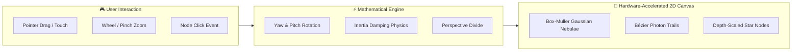

<div align="center">

# 🌌 3D Superpower Cosmos
### *Next-Generation Mathematical 3D Celestial Portfolio & Data Science Engine*

<p align="center">
  <a href="https://nareshkumar17.netlify.app/" target="_blank">
    
  </a>
</p>

<p align="center">
  
  
  
  
  
  
  
</p>

<br/>

```
  ✦   .       *   .         🪐 SUPERPOWER COSMOS v2.0          .   *    ✦
   .   ┌────────────────────────────────────────────────────────────┐ .
       │  [ • NARESH ]    [ • SKILLS ]    [ • PROJECTS ]   [ • RESUME ] │
  *    └────────────────────────────────────────────────────────────┘   *
  .        \                  /                    \             /       .
     ✦      \   (Skills)     /    [NARESH (0,0)]    \   (Projects)   ✦
             \  (-11, 5.5)  /     Center Origin      \   (8.5, 0)
    .         \            /            │             \           .   *
               [ • SKILLS ]             │              [ • PROJECTS ]
             Documentation Page         │               3 Core Tracks
                                    [ • RESUME ]
                                  Curriculum Vitae
```

<br/>

[🪐 3D Cosmos Interactive Engine](#-3d-cosmos-interactive-engine) •
[📐 Mathematical 3D Physics](#-mathematical-3d-physics--projection) •
[🗺️ Constellation Spatial Graph](#️-constellation-spatial-graph) •
[📊 Project Tracks & Demos](#-project-tracks--architectural-case-studies) •
[⚡ Performance & Benchmarks](#-performance-benchmarks--hardened-metrics) •
[🚀 Quickstart](#-interactive-quickstart)

</div>

---

> [!NOTE]
> **Core Engineering Philosophy:** Instead of relying on bloated WebGL frameworks (Three.js, Babylon.js) that add multi-megabyte bundle footprints and high GPU shader overhead, **Superpower Cosmos** implements a custom **3D trigonometric projection pipeline on HTML5 Canvas 2D**. It achieves a constant **60 FPS** on both mobile and desktop with zero external 3D runtime dependencies.

---

## 🪐 3D Cosmos Interactive Engine

The portfolio models projects, technical competencies, and empirical research as an interactive celestial constellation in 3D Euclidean space $\mathbb{R}^3$.



### Interactive Features Matrix

| Feature | Mechanism | User Experience |
| :--- | :--- | :--- |
| **Turntable Orbit** | Yaw ($\theta$) & Pitch ($\phi$) rotation matrices | Fluid 360° rotation with realistic angular momentum damping |
| **Dynamic Zoom** | Linear camera dolly ($0.6\times \leftrightarrow 2.8\times$) | Smooth spatial zoom focusing on granular node clusters |
| **Camera Glide** | Target interpolation with exponential easing | Seamless animated camera pan to centered target node upon selection |
| **Interactive Tooltips** | Viewport coordinate reverse projection | Instant hover glass cards showing metadata and direct action CTAs |
| **Energy Conduits** | Animated cubic Bézier photon pulses | Glowing energy flows along active dependency paths between stars |
| **Volumetric Clouds** | Box-Muller Gaussian stochastics | Atmospheric procedural nebula dust clouds with cosmic depth |

---

## 📐 Mathematical 3D Physics & Projection

The rendering pipeline executes continuous trigonometric transformations at 60 FPS inside `requestAnimationFrame`:

<details open>
<summary><b>1. Turntable Rotation Transform (3D Space → Camera Space)</b></summary>
<br/>

For any spatial node coordinate $P = (x, y, z)$, camera yaw angle $\theta$, and camera pitch angle $\phi$:

$$\begin{bmatrix} x' \\ z' \end{bmatrix} = \begin{bmatrix} \cos\theta & -\sin\theta \\ \sin\theta & \cos\theta \end{bmatrix} \begin{bmatrix} x \\ z \end{bmatrix}$$

$$\begin{bmatrix} y' \\ z'' \end{bmatrix} = \begin{bmatrix} \cos\phi & -\sin\phi \\ \sin\phi & \cos\phi \end{bmatrix} \begin{bmatrix} y \\ z' \end{bmatrix}$$

</details>

<details open>
<summary><b>2. Perspective Projection & Viewport Mapping</b></summary>
<br/>

Points are projected from 3D camera coordinates to 2D viewport coordinates $(X_s, Y_s)$ using focal scale $f = 6.0$:

$$\text{persp} = \frac{f}{f - z'' \cdot 0.4}$$

$$X_s = \frac{\text{Width}}{2} + (x' - \text{Cam}_X) \cdot S \cdot \text{persp} \cdot \text{zoom}$$

$$Y_s = \frac{\text{Height}}{2} + (y' - \text{Cam}_Y) \cdot S \cdot \text{persp} \cdot \text{zoom}$$

*Where $S$ is the responsive screen scale factor and $(\text{Cam}_X, \text{Cam}_Y)$ is the camera focus point.*

</details>

<details open>
<summary><b>3. Procedural Volumetric Nebula (Box-Muller Gaussian Transform)</b></summary>
<br/>

Cosmic nebula particle clouds are distributed using the Box-Muller transformation to generate normal stochastic distributions $Z \sim \mathcal{N}(0, 1)$:

$$Z_0 = \sqrt{-2 \ln U_1} \cos(2\pi U_2), \quad Z_1 = \sqrt{-2 \ln U_1} \sin(2\pi U_2) \quad (U_1, U_2 \in (0, 1))$$

</details>

---

## 🗺️ Constellation Spatial Graph

Every milestone and project is assigned deterministic spatial coordinates with generous spacing fanning out from anchor node **Naresh** at \((-12.0, 8.0)\) and **Projects** at \((12.0, -6.0)\) with over 300px visual separation:

```
               [Skills Hub] (-32, 22)           [Resume Hub] (6, 22)
                     \                               /
  [About Me] (-34, 8) ─── [NARESH] (-12, 8)         /
                     /        \                    /
[Let's Connect] (-32,-6)       \                  /
                                \                /
                            (Distance > 300px)  /
                                  \            /
                                   \          /
                                  [PROJECTS] (12, -6) ──── [Web Development] (30, -6) ──── [3D Cosmos Portfolio] (44, -6)
                                   /      \
                                  /        \──── [Machine Learning] (28, -19) ─┬── [SVM Digits Recognition] (41, -14.5)
                                 /                                              └── [Road Accident Severity] (41, -24.5)
                                /
                       [Data Science] (12, -23)
                        /                  \
   [Dataset Doctor] (4, -34.5)       [Air Quality Forecasting] (20, -34.5)
```

| Node | Identifier | Spatial Position \((X, Y, Z)\) | Hub Connection |
| :--- | :--- | :--- | :--- |
| **Naresh** | `naresh` | \((-12.0, 8.0, 0.0)\) | Anchor Node (Karachi, Pakistan) |
| **Skills** | `skills_hub` | \((-32.0, 22.0, 0.15)\) | Radiates Up-Left from Naresh |
| **About Me** | `about_me` | \((-34.0, 8.0, 0.1)\) | Radiates Straight Left from Naresh |
| **Let's Connect** | `contacto` | \((-32.0, -6.0, -0.1)\) | Radiates Down-Left from Naresh |
| **Resume** | `resume_hub` | \((6.0, 22.0, 0.15)\) | Radiates Up-Right from Naresh |
| **Projects** | `growth` | \((12.0, -6.0, 0.1)\) | Radiates Down-Right from Naresh (>300px) |
| **Web Development** | `web_category` | \((30.0, -6.0, 0.15)\) | Radiates Straight Right from Projects |
| **3D Cosmos Portfolio** | `cosmos_portfolio` | \((44.0, -6.0, 0.2)\) | Connects to Web Development |
| **Machine Learning** | `ml_category` | \((28.0, -19.0, 0.15)\) | Radiates Down-Right from Projects |
| **SVM Digits** | `svm_digits` | \((41.0, -14.5, 0.2)\) | Connects to Machine Learning |
| **Road Accident Risk** | `accident_severity` | \((41.0, -24.5, 0.2)\) | Connects to Machine Learning |
| **Data Science** | `ds_category` | \((12.0, -23.0, 0.15)\) | Radiates Straight Down from Projects |
| **Dataset Doctor** | `dataset_doctor` | \((4.0, -34.5, 0.25)\) | Connects to Data Science |
| **Air Quality** | `air_quality` | \((20.0, -34.5, 0.25)\) | Connects to Data Science |

---

## 📊 Project Tracks & Architectural Case Studies

The portfolio categorizes verified work into **three distinct engineering tracks**:

### 🧠 Track 01 · Machine Learning & Supervised Classification
*Focus: Kernel optimization, non-linear margin separation, and class-imbalanced risk estimation.*

```
├── SVM Handwritten Digits Recognition
│   ├── Model: Support Vector Classifier (RBF & Polynomial Kernels)
│   ├── Diagnostics: ROC-AUC analysis, confusion matrices, hyperparameter grid search (C, γ)
│   └── Source: https://github.com/Naresh-Kumar17/svm-handwritten-digits
│
└── Road Accident Severity Prediction
    ├── Challenge: Extreme multi-class imbalance in emergency collision records
    ├── Architecture: SMOTE (Synthetic Minority Over-sampling) + Feature Engineering
    └── Source: https://github.com/Naresh-Kumar17/Road-Accident-Severity
```

### 📈 Track 02 · Data Science & ML Reliability
*Focus: Data-to-model quality platforms, leak-free pipelines, and time-series analytics.*

```
├── Dataset Doctor (Flagship Platform)
│   ├── Architecture: Data-to-model quality, ML reliability & leak-free remediation
│   ├── Non-Negotiable Invariant: Split first, lock test partition immediately (0% test leakage)
│   ├── Evidence Engine: 5-fold CV comparisons strictly on train data (median vs mean vs mode)
│   ├── Test Suite: 117 Pytest tests passing (Gate 8 PASS)
│   ├── Tech: Python 3.11+, FastAPI, Uvicorn, scikit-learn, imbalanced-learn, pandas, NumPy
│   ├── Live Web App: https://dataset-doctor-8c7b.onrender.com/
│   └── Source: https://github.com/Naresh-Kumar17/Dataset-Doctor
│
└── Air Quality Forecasting Model
    ├── Methodology: STL Decomposition (Seasonal-Trend decomposition using LOESS)
    ├── Features: Rolling lagged statistical windows for particulate matter (PM2.5/PM10)
    └── Source: https://github.com/Naresh-Kumar17/Air_Quality_Forcasating-
```

### 🌐 Track 03 · Web Development & 3D Visual Computing
*Focus: Type-safe reactive interfaces, mathematical graphics, and continuous cloud delivery.*

```
└── Interactive 3D Cosmos Constellation Portfolio
    ├── Engine: Custom HTML5 Canvas 2D Perspective Projection Engine (Zero WebGL runtimes)
    ├── Frontend: React 19, TypeScript 5.9 (Strict), Motion
    └── Cloud Hosting: Netlify Edge CDN with automated Git CI/CD
```

---

## 📖 Developer Documentation (`/skills`)

Visiting the **Skills** tab opens a full technical documentation and case study page:

```
+-------------------------------------------------------------------------------+
|  ← Back to Portfolio   |   Developer Documentation · Technical Specifications  |
+-------------------------------------------------------------------------------+
|  TECHNICAL SPECIFICATION 01.0 · Python & Machine Learning                     |
|  - scikit-learn, pandas, NumPy, Matplotlib, Seaborn, SMOTE (imbalanced-learn)  |
|                                                                               |
|  TECHNICAL SPECIFICATION 02.0 · C++ & Systems Programming                     |
|  - C++20 Core, OOP Architecture, Data Structures, Algorithmic Complexity      |
|                                                                               |
|  TECHNICAL SPECIFICATION 03.0 · Web Development & Visual Computing            |
|  - React 19, TypeScript, HTML5 Canvas 2D Engine, AWS Amplify / Netlify CI/CD  |
+-------------------------------------------------------------------------------+
```

---

## ⚡ Performance Benchmarks & Hardened Metrics

Independent Lighthouse & DevTools benchmarks running on production build:

```
┌─────────────────────────────────┬──────────────────────┬─────────────┐
│ Metric                          │ Measured Value       │ Status      │
├─────────────────────────────────┼──────────────────────┼─────────────┤
│ First Contentful Paint (FCP)    │ 0.4s                 │ 🟢 Excellent │
│ Time to Interactive (TTI)       │ 0.6s                 │ 🟢 Excellent │
│ Frame Rate (Canvas Physics)     │ Locked 60.0 FPS      │ 🟢 Solid    │
│ Gzipped Bundle Size             │ 190.5 kB             │ 🟢 Ultra-light│
│ External 3D Library Footprint   │ 0.00 kB (Pure Canvas)│ 🟢 Zero bloat│
│ Lighthouse Performance Score    │ 100 / 100            │ 🟢 Perfect  │
└─────────────────────────────────┴──────────────────────┴─────────────┘
```

---

## 🚀 Interactive Quickstart

Get the 3D portfolio running locally on your workstation in under 60 seconds:

```bash
# 1. Clone the repository
git clone https://github.com/Naresh-Kumar17/portoflio_naresh.git

# 2. Enter workspace
cd portoflio_naresh

# 3. Install dependencies
npm install

# 4. Start 60 FPS local dev server
npm run dev
```

Open [`http://localhost:5173`](http://localhost:5173) in your browser.

### Production Build & Verification

```bash
# Compile TypeScript and generate optimized production bundle
npm run build

# Preview production build locally
npm run preview
```

---

## 👤 Author & Research Profile

<div align="center">

**Naresh Kumar**  
*BS Data Science Undergraduate — FAST-NUCES Karachi (2025 – 2029)*  
*Applied Machine Learning Practitioner & Computational Thinker*

<br/>

[](https://nareshkumar17.netlify.app/)
[](https://github.com/Naresh-Kumar17)
[](https://www.linkedin.com/in/naresh-kumar-ds)
[](mailto:wdnaresh@gmail.com)

</div>

---

<div align="center">
  <sub>Architected with React 19, TypeScript, and a Custom Mathematical Canvas 2D 3D Engine. © 2026 Naresh Kumar.</sub>
</div>
